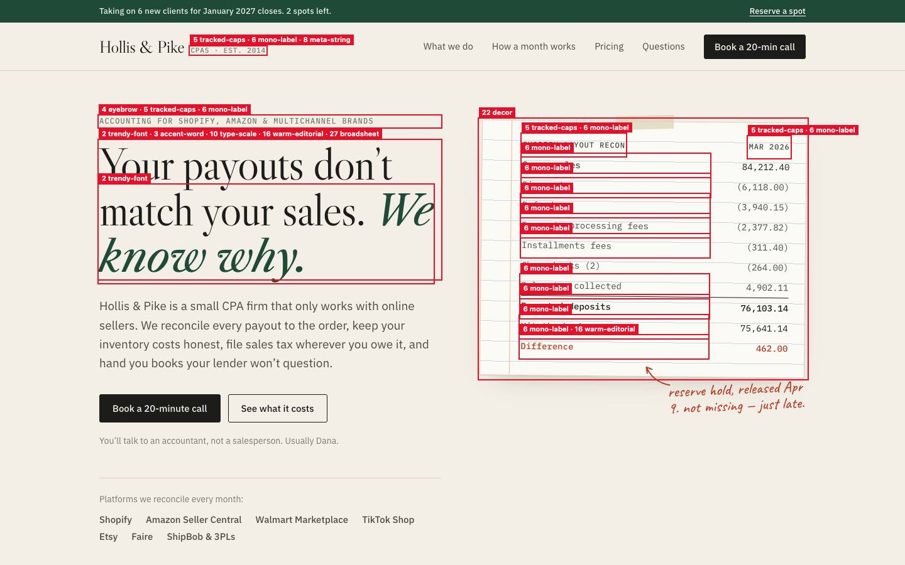
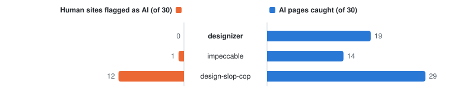
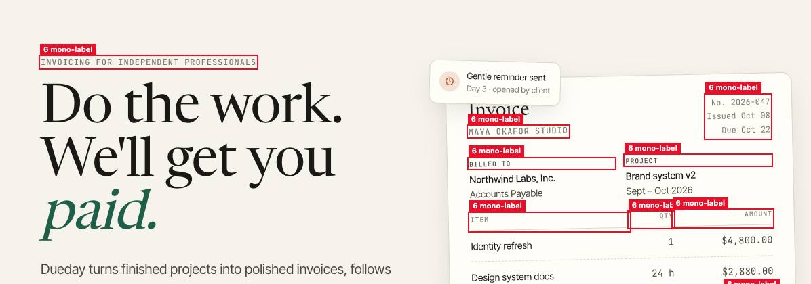

# designizer

**humanizer for UI: finds the default AI look in your interface and fixes it**



designizer is a Claude Code skill with a measuring tool inside. The tool, `detector.js`, is one file with no dependencies. It runs inside a rendered page and reads computed styles and layout, so Tailwind, React, Astro and hand-written CSS all look the same to it. For each element that matches a known AI default it reports the measurements behind the match (`letter-spacing 0.14em, 11px, uppercase`). The skill adds what a script can't see: the page's composition, invented testimonials, and whether a pattern follows from the product. Then it proposes the smallest CSS change and applies it only after you say yes.

The name and the structure come from [humanizer](https://github.com/blader/humanizer), which does the same for text. Copy found on a page is handed over to it.

## Results

Results on test-b, a held-out split the detector never saw while it was being built: 30 pages generated with Claude Code and 30 human-designed sites. Seven of the human sites are hard cases with the look AI imitates: the product sites of Notion, Apple, Supabase, Resend, Mercury and Cal.com, and rauchg.com. Each tool's threshold was tuned on the development pages, then applied unchanged. Run on 2026-10-22.

<!-- eval -->
<picture>
  <source media="(prefers-color-scheme: dark)" srcset="eval/charts/results-dark.svg">
  
</picture>

| Tool | Accuracy | AI pages caught | Human pages flagged as AI | Verdict rule |
|---|---|---|---|---|
| designizer | 82% | 19 / 30 | 0 / 30 | threshold in detector.js |
| impeccable | 72% | 14 / 30 | 1 / 30 | score ≥ 5 (tuned on dev + test) |
| design-slop-cop | 78% | 29 / 30 | 12 / 30 | score ≥ 7 (tuned on dev + test) |

<picture>
  <source media="(prefers-color-scheme: dark)" srcset="eval/charts/patterns-dark.svg">
  
</picture>
<!-- /eval -->

designizer flagged none of the human sites and 19 of the 30 AI pages. design-slop-cop catches more AI pages but also flags 12 human sites, because gradients, glass and a pill above the headline are common on well-designed product sites. impeccable, at its best threshold, flags one human site and catches 14 AI pages.

All 11 AI pages designizer missed came from two prompts: 10 from "use the frontend-design skill" (0 of 10 caught) and one from "make it look less AI-generated" (10 of 11 caught). Plain prompts were caught 9 out of 9. The skill's pages don't have the default look, and flagging them would mean measuring something other than the look.

Current Claude output has also moved past the first wave. Purple buttons, gradient text, glass and fake window chrome hardly appear in the 70 generated eval pages. The tells now are a template display font, one italic or coloured word in the headline, `A · B · C` meta lines, cream with a serif and terracotta, eyebrows, monospace labels and 01/02/03.

The first held-out run missed the target. All three runs:

| Version | Pages | Accuracy | Human pages flagged | Note |
|---|---|---|---|---|
| v1 | test (30 + 30) | 75% | 5 / 30 | held out; Linear, Stripe, Raycast, Hey and The Verge flagged |
| v2 | dev + test (40 + 40) | 81% | 2 / 40 | not held out: the data used to choose which patterns count |
| v2 | test-b (30 + 30) | 82% | 0 / 30 | held out; the table above |

With 30 + 30 pages the margin of error on accuracy is about ±10 points, so "82%" means somewhere between the low seventies and the low nineties. The false-alarm rate is the steadier number: 0 in 30 here and 2 in 40 on the development pages.

One of the 34 example screenshots, monospace labels on an invoice mock-up (`ai-01`):



## Install

```bash
git clone https://github.com/nightherd/designizer ~/.claude/skills/designizer
cd ~/.claude/skills/designizer && npm install
```

The CLI drives your installed Google Chrome through `playwright-core`, so nothing else is downloaded. Then ask Claude Code "does this page look AI-generated?" or "make localhost:3000 look less AI".

## Use the detector without the skill

```bash
node cli.mjs scan https://example.com --overlay overlay.jpg   # JSON report + screenshot with red outlines
node cli.mjs scan ./index.html --only eyebrow,mono-label --overlay eyebrow.jpg
```

Or paste `detector.js` into the DevTools console of any page:

```js
designizer.scan()      // { score, threshold, verdict, fired: [{ id, n, strength, scored, hits: [{ selector, evidence }] }] }
designizer.overlay()   // red outlines with the pattern name; designizer.clear() removes them
```

Decisions you made on purpose go in `.designizer.json` at the project root, and designizer stops reporting them:

```json
{ "allow": ["trendy-font", "accent-word"], "ignore": [".receipt"] }
```

## Patterns

The full catalogue, with what counts as a reason to keep each one, is in [SKILL.md](SKILL.md). Strength works as in humanizer: a strong pattern is worth fixing on its own, a weak one only next to others. Unscored patterns are still reported, but they don't count toward the page verdict, because in the development data they fired on at least as many human pages as AI ones.

<!-- patterns -->
| # | Pattern | Id | Strength | Counts toward verdict | Example |
|---|---|---|---|---|---|
| 1 | Default sans everywhere | `default-sans` | weak | yes | [ai-02](examples/01-default-sans.jpg) |
| 2 | Template display font | `trendy-font` | weak | yes | [ai-01](examples/02-trendy-font.jpg) |
| 3 | One accented word in a heading | `accent-word` | strong | yes | [ai-01](examples/03-accent-word.jpg) |
| 4 | Tracked caps eyebrow over a heading | `eyebrow` | medium | yes | [ai-01](examples/04-eyebrow.jpg) |
| 5 | Tracked all-caps labels | `tracked-caps` | medium | yes | [ai-01](examples/05-tracked-caps.jpg) |
| 6 | Monospace labels that are not code | `mono-label` | medium | yes | [ai-01](examples/06-mono-label.jpg) |
| 7 | 01 / 02 / 03 numbering | `numbered` | medium | yes | [ai-01](examples/07-numbered.jpg) |
| 8 | A · B · C meta strings | `meta-string` | weak | yes | [ai-01](examples/08-meta-string.jpg) |
| 9 | Arrow on every link | `arrow-links` | weak | no | [ai-37](examples/09-arrow-links.jpg) |
| 10 | Sentence-long display headline or flat scale | `type-scale` | weak | yes | [ai-04](examples/10-type-scale.jpg) |
| 11 | Crushed tracking on display type | `crushed-tracking` | weak | yes | [ai-10](examples/11-crushed-tracking.jpg) |
| 12 | Purple or indigo buttons | `purple` | medium | no | [ai-11](examples/12-purple.jpg) |
| 13 | Gradient text | `gradient-text` | strong | no | [ai-65](examples/13-gradient-text.jpg) |
| 14 | Gradients, blobs and halos everywhere | `gradients` | medium | yes | [ai-02](examples/14-gradients.jpg) |
| 15 | Dark mode with grey text and coloured glow | `dark-glow` | medium | no | [ai-19](examples/15-dark-glow.jpg) |
| 16 | Cream, serif and terracotta | `warm-editorial` | medium | yes | [ai-01](examples/16-warm-editorial.jpg) |
| 17 | Near-black with one acid accent | `dark-acid` | medium | no | [ex-05](examples/17-dark-acid.jpg) |
| 18 | One radius and one shadow on every card | `card-kit` | weak | no | [ai-28](examples/18-card-kit.jpg) |
| 19 | Coloured stripe on a card edge | `side-stripe` | strong | yes | [ai-09](examples/19-side-stripe.jpg) |
| 20 | Cards inside cards | `nested-cards` | medium | yes | [ai-03](examples/20-nested-cards.jpg) |
| 21 | Glassmorphism | `glass` | medium | no | [ai-39](examples/21-glass.jpg) |
| 22 | Ghost cards, grid background or grain | `decor` | weak | yes | [ai-07](examples/22-decor.jpg) |
| 23 | Pill badge over a centred hero | `hero` | medium | no | [ai-11](examples/23-hero.jpg) |
| 24 | Identical cards with an icon | `icon-cards` | weak | yes | [ai-01](examples/24-icon-cards.jpg) |
| 25 | Row of big numbers | `stat-row` | medium | yes | [ai-01](examples/25-stat-row.jpg) |
| 26 | Stock page order (FAQ accordion) | `faq` | weak | yes | [ai-01](examples/26-faq.jpg) |
| 27 | Newspaper cosplay | `broadsheet` | medium | yes | [ai-01](examples/27-broadsheet.jpg) |
| 28 | Fake window chrome or terminal | `fake-window` | medium | no | [ex-02](examples/28-fake-window.jpg) |
| 29 | Same spacing everywhere | `uniform-spacing` | weak | yes | [ai-05](examples/29-uniform-spacing.jpg) |
| 30 | Every section fades up | `reveal` | medium | no | [ai-01](examples/30-reveal.jpg) |
| 31 | Pulsing dot, marquee or blinking cursor | `infinite-motion` | medium | no | [ai-04](examples/31-infinite-motion.jpg) |
| 32 | Bouncy easing | `bounce` | weak | yes | [ai-17](examples/32-bounce.jpg) |
| 33 | Emoji as icons | `emoji` | strong | yes | [ai-11](examples/33-emoji.jpg) |
| 34 | Invented testimonials and numbers | model only | strong / medium | – | – |
| 35 | Sparkles and robots as the AI icon | `sparkles` | medium | no | [ai-11](examples/35-sparkles.jpg) |
| 36 | Template copy | model only | strong / medium | – | – |
<!-- /patterns -->

## How the evaluation works

### AI pages

75 landing pages built by Claude Code with `claude -p` on a subscription. Each prompt is one line ("Build a landing page for a family dental clinic in Denver"). Pages come from Opus, Sonnet or Haiku 5.5 with one of three prompts: plain, plain plus "make it look less AI-generated", or "use the frontend-design skill". Every model meets every variant equally often. Generation runs in an empty temp directory with user settings switched off, so no personal instructions, hooks or plugins leak in. All prompts and the resulting files are in [`eval/ai.json`](eval/ai.json) and [`eval/ai/`](eval/ai/); `npm run generate` rebuilds missing ones. Five of them (`ex-01`…`ex-05`) only exist to give first-wave patterns an example screenshot and are not part of the eval; `ex-05` was asked for its palette outright.

### Human pages

70 sites: design studios, type foundries, publishers, product companies with in-house design teams, brands and personal portfolios. Every site was compared with its Wayback Machine snapshot from June 2024, and kept only if the current design already existed then, before AI-built sites were common. The exceptions are hard negatives such as Linear and Stripe, kept because in-house design teams made them. The repo stores only their URLs and the scores, never their code or screenshots ([`eval/human.json`](eval/human.json), [`eval/results.json`](eval/results.json)).

### Protocol

The commit history shows this order:

1. Rules were written against the dev split (10 AI + 10 human). The threshold was set to the lowest score at which no human dev page was flagged, and the detector was frozen ([3bc891d](../../commit/3bc891d)).
2. One run on the held-out test split (30 + 30) scored 75% with 5 human pages flagged, below the target (at least 80% accuracy, at most 3 human pages flagged).
3. Using dev and test together as development data (80 pages), 12 patterns that fired on at least as many human as AI pages were left out of the score. The threshold stayed at 10. Frozen again ([9128f39](../../commit/9128f39)).
4. A fresh split, test-b (30 + 30), was generated and picked only after that freeze ([0ff739d](../../commit/0ff739d)) and run once. The table above is that run. Between the freeze and the run, one fix went in for a rule that does not count toward the verdict (window dots next to a title).

### Baselines

[design-slop-cop](https://github.com/AdrianKrebs/design-slop-cop) (MIT, commit `e2fab6c`) and [impeccable](https://github.com/pbakaus/impeccable)'s in-page engine (Apache-2.0, `engine-v0.1.12`) run on the same loaded page as designizer, from [`eval/baselines.mjs`](eval/baselines.mjs). Neither has a single "this is AI" threshold that fits this task, so each gets the threshold that maximises its accuracy on the same development pages designizer was tuned on: dev for the first test run, dev + test for test-b.

### Reproduce

```bash
npm install
node cli.mjs eval --split test-b --baselines   # or dev, test, dev,test, all; --write updates this README
```

Human sites change, so a rerun on another day can differ by a page or two.

### Limits

- 30 + 30 pages give a margin of error of about ±10 percentage points on accuracy.
- AI pages are single-file prototypes from one vendor's models. Pages from v0, Lovable or Bolt, deployed apps and other models are not in the set.
- The human set is professional design. A small business site set in a free Google Font would score higher on patterns 1 and 2. That is why those two stay weak, even though no human page in the set used a template display font.
- AI pages have no real photography, and human sites do. To keep that from doing the work, designizer has no rule about images.
- The detector measures the look, but the eval labels pages by origin. A page generated with a careful design brief may not have the look at all, and then no detector should flag it (see the prompt breakdown under Results).

## Credits

Pattern sources: [Impeccable's slop list](https://impeccable.style/slop), Adrian Krebs's [audit of 1,590 Show HN pages](https://www.adriankrebs.ch/blog/design-slop/), [Capital & Compute](https://capitalandcompute.net/blog/fix-ai-slop-design/) on the second wave, [Developers Digest](https://www.developersdigest.tech/blog/ai-design-slop-and-how-to-spot-it), [prg.sh](https://prg.sh/ramblings/Why-Your-AI-Keeps-Building-the-Same-Purple-Gradient-Website), [925studios](https://www.925studios.co/blog/ai-slop-design-tells), [CodeMySpec](https://codemyspec.com/blog/vibe-coded-websites-look-the-same), [vibecoded-design-tells](https://github.com/JCarterJohnson/vibecoded-design-tells), [ai-design-tells](https://github.com/hankimis/ai-design-tells), and Anthropic's [frontend-design](https://github.com/anthropics/skills) skill, whose current version describes the second-wave look. Skill structure after [humanizer](https://github.com/blader/humanizer) by Siqi Chen (MIT).

MIT licence.
